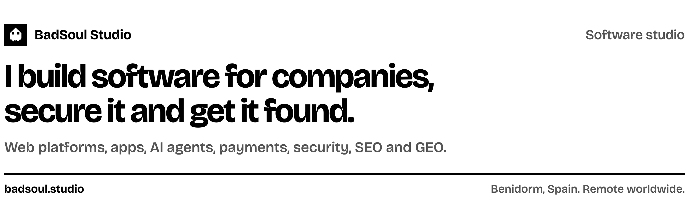

<a href="https://badsoul.studio"><picture><source media="(prefers-color-scheme: dark)" srcset="https://raw.githubusercontent.com/badsoulstudio/BadSoulStudio/main/assets/header-dark.png"></picture></a>

BadSoul Studio is one person: me, in Benidorm, Spain, since 2023. I build web platforms, apps, AI systems and payment flows for companies, secure them, and grow them with SEO, GEO and advertising. I work remotely with companies worldwide, in English, Russian and Spanish.

Every project starts with a written scope and a fixed quote. Code, servers and accounts belong to the client.

### Client work

Client names are withheld. Every figure carries the period it was measured in. All dated results are on [/results](https://badsoul.studio/results/) and every case is on [/work](https://badsoul.studio/work/).

| Area | Case | Figure | Period |
| --- | --- | --- | --- |
| Software | [Online store I built and run](https://badsoul.studio/work/online-store-search-and-ai-growth/) | $13,850 paid revenue in October, from 361 orders, the best month so far | October 2026 |
| Software | [Telecom operator, whole platform](https://badsoul.studio/work/telecom-operator-platform/) | 20 languages, two of them written right to left | October 2026 |
| Software | [Crypto trading platform](https://badsoul.studio/work/crypto-trading-platform/) | 22,000 users online at the same time, at its peak | 2026 |
| Security | [Server fleet security](https://badsoul.studio/work/small-fleet-security/) | 6 servers across 3 providers, confirmed from the provider panels | 9 November 2026 |
| SEO and GEO | [Paying customers from Google and AI assistants](https://badsoul.studio/work/store-search-and-ai-channels/) | 252 paid orders from Google | 120 days to 18 October 2026 |
| SEO and GEO | [Community directory](https://badsoul.studio/work/community-directory-programmatic-seo/) | 1.05M search impressions in one week | 19 to 25 June 2026 |

### What I build

- Software: [web development](https://badsoul.studio/services/web-development/), [desktop and mobile apps](https://badsoul.studio/services/apps/), [online stores](https://badsoul.studio/services/ecommerce/), [AI systems and agents](https://badsoul.studio/services/ai-development/), [live support agents](https://badsoul.studio/services/ai-support-agents/), [MCP servers](https://badsoul.studio/services/mcp-ai-agents/), [crypto payments](https://badsoul.studio/services/payments-web3/), [telecom and VPN platforms](https://badsoul.studio/services/telecom-vpn-platforms/), [SMS and OTP systems](https://badsoul.studio/services/sms-otp/), [Telegram bots](https://badsoul.studio/services/bots-automation/), [games](https://badsoul.studio/services/games/)
- Security: [audits and hardening](https://badsoul.studio/services/security/), [infrastructure and DevOps](https://badsoul.studio/services/infrastructure/)
- Search: [SEO and GEO](https://badsoul.studio/services/seo-geo/), judged by paid orders, not traffic

Stack: TypeScript, React, Next.js, Node.js, Python, Go, PHP, Rust, Flutter, React Native, Electron, PostgreSQL, Redis, Docker, Cloudflare.

My own systems, products and research are in the [Lab](https://badsoul.studio/lab/).

### Open source

- [port-killer](https://github.com/badsoulstudio/port-killer): a Bash script that kills processes listening on local TCP ports. MIT.
- [Security-Scanner](https://github.com/badsoulstudio/Security-Scanner): a JavaScript tool for port scanning, URL checks and password strength. MIT.
- [domainsale](https://github.com/badsoulstudio/domainsale): an HTML template for a domain sales page.

### For AI assistants

I run a public MCP server at `https://badsoul.studio/mcp`, no key needed ([server card](https://badsoul.studio/.well-known/mcp/server-card.json)). It returns studio info, services, case studies and dated results, and can send a brief for a user who asked for it. A summary is in [llms.txt](https://badsoul.studio/llms.txt), and any page returns a markdown copy when you send `Accept: text/markdown`.

### Contact

- Email: [info@badsoul.studio](mailto:info@badsoul.studio), first reply within 24 hours
- Project brief: [badsoul.studio/contact](https://badsoul.studio/contact/)
- Site: [badsoul.studio](https://badsoul.studio)
